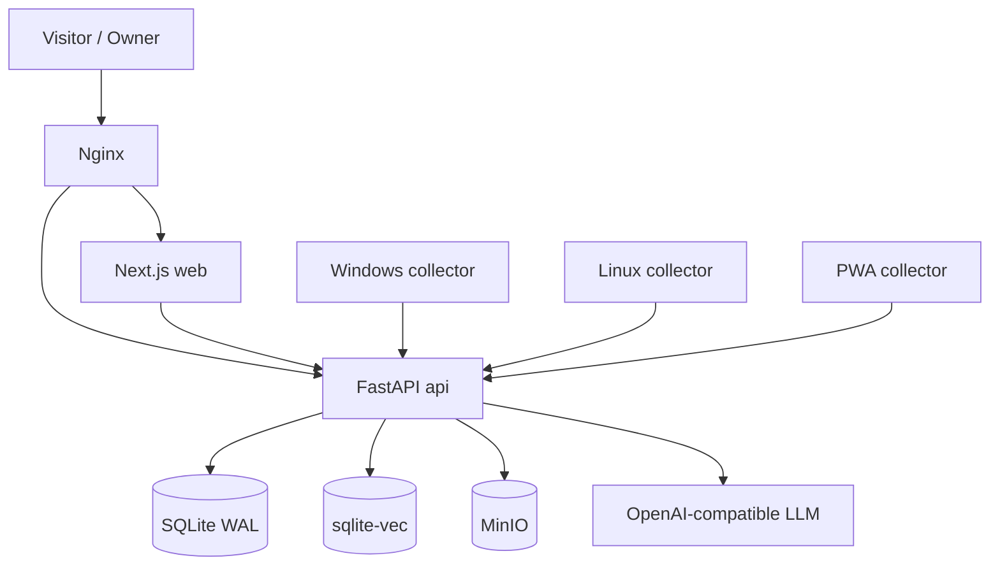

<div align="center">


# LYPH

**A small, self-hosted home for words, agents, and screenshots.**

[简体中文](README.md) · [English](README.en.md)

[](https://nextjs.org/)
[](https://fastapi.tiangolo.com/)
[](https://www.rust-lang.org/)
[](https://docs.docker.com/compose/)
[](LICENSE)

[Quick start](#quick-start) · [Architecture](#architecture) · [Configuration](#configuration) · [Deployment](#deployment) · [Privacy](#privacy) · [Development](#development)

</div>

---

## What is this

LYPH is a **self-hosted personal site + AI agent + capture client** reference implementation.

It is not a SaaS or a generic template. It combines:

```text
Public site / blog / docs / journal / projects
        +
Owner admin (content, profile, models, chat, devices, daily reports, ops, backup)
        +
AI chat (OpenAI-compatible / RAG / MCP / rich views)
        +
Windows / Linux / PWA collectors (screenshots, notes, daily reports)
        +
Docker Compose + Nginx + MinIO + SQLite
```

Good fit for:

- A fully self-hosted personal homepage / blog / docs site
- Letting visitors talk to your own site AI instead of a generic chat box
- Capturing desktop screenshots and notes from Windows/Linux into daily reports
- Studying a complete but restrained FastAPI + Next.js + Rust stack
- Deploying on your own server instead of a SaaS

---

## Features

| Area | Highlights |
|---|---|
| Public site | Home, projects, stack, interests, blog, docs, journal; warm paper layout; responsive |
| Publishing | Drafts, publish snapshots, version restore, public/private, RAG authorization |
| Admin | Content, profile, models, chat, devices, reports, ops, backup, settings |
| Auth | Argon2id, HttpOnly cookie, CSRF, login throttling |
| AI | OpenAI-compatible chat, RAG with sqlite-vec, MCP/AG-UI, SSE, rich views |
| Chat controls | Quota, concurrency, cache, cancel, resume, idempotency |
| Collectors | Rust core + SQLite queue; Windows Tauri; Linux daemon/TUI; PWA |
| Storage | MinIO private objects; SQLite WAL; signed/controlled downloads |
| Deploy | Docker Compose, Nginx, optional ACME/TLS, backup/restore CLI |

---

## Architecture



| Layer | Stack |
|---|---|
| Web | Next.js 15.5, React 19, TypeScript, Tailwind CSS 4 |
| API | Python 3.13, FastAPI, SQLite WAL, sqlite-vec, APScheduler |
| AI | OpenAI-compatible Chat Completions, RAG, MCP, AG-UI |
| Storage | MinIO / S3-compatible |
| Collectors | Rust, Tauri, Ratatui, rusqlite, reqwest |
| Deploy | Docker Compose, Nginx, Certbot |

See [`docs/ARCHITECTURE.md`](docs/ARCHITECTURE.md) for data flows and module details.

---

## Quick start

### Requirements

- Docker + Docker Compose **≥ 2.24.4**
- Python 3.13 + [uv](https://docs.astral.sh/uv/) (only to generate config)
- A Linux server / NAS that can run Docker

### 1. Clone and generate config

```bash
git clone https://github.com/Wing233/lyph.git
cd lyph

uv run --project api lyph init-config \
  --output .env \
  --origin http://127.0.0.1:8080 \
  --minio-endpoint minio:9000
```

This generates `LYPH_SECRET_KEY`, MinIO keys, and an Argon2id owner password hash. It refuses to overwrite an existing `.env` and never prints secrets.

There is **no default password, API key, or demo model**.

### 2. Build and start

```bash
docker compose build minio api web
docker compose up -d
```

Open:

```text
http://127.0.0.1:8080/
http://127.0.0.1:8080/admin/login
```

### 3. Configure a model

Admin → Models → add an OpenAI-compatible endpoint:

```text
base_url   https://api.deepseek.com
model      deepseek-chat
api_key    sk-...
```

Keys are encrypted server-side and never echoed to the browser. If no model is configured, chat fails explicitly instead of faking an answer.

### 4. Optional TLS

```bash
# First certificate (port 80 only)
docker compose -f compose.yaml -f compose.acme.yaml up -d

# Production TLS
docker compose -f compose.yaml -f compose.tls.yaml up -d
```

`LYPH_CERT_NAME` is required; there is no built-in IP/domain default.

---

## Configuration

See [`.env.example`](.env.example) and [`docs/CONFIGURATION.md`](docs/CONFIGURATION.md).

Required:

```text
LYPH_SECRET_KEY
LYPH_OWNER_PASSWORD_HASH
LYPH_FRONTEND_ORIGIN
LYPH_SECURE_COOKIES
LYPH_MINIO_ENDPOINT
LYPH_MINIO_ACCESS_KEY
LYPH_MINIO_SECRET_KEY
LYPH_MINIO_BUCKET
LYPH_MINIO_SECURE
```

Common:

```text
LYPH_BIND_ADDRESS      127.0.0.1
LYPH_HTTP_PORT         8080
LYPH_PROXY_IP          172.30.91.254
LYPH_PRIVATE_SUBNET    172.30.91.0/24
FORWARDED_ALLOW_IPS    172.30.91.254
LYPH_CERT_NAME         your-domain.example
```

Optional:

```text
LYPH_CHAT_FIRST_ENABLED
LYPH_PUBLIC_ORIGIN
LYPH_ENTERPRISE_DATABASE_PATH
LYPH_DOCKER_GID
LYPH_SCHEDULER_ENABLED
```

`.env`, `data/`, `runtime/`, `backups/`, and `public-apps/` are gitignored.

---

## Development

### API

```bash
cd api
uv sync --frozen --extra test
uv run --env-file ../.env uvicorn lyph.main:app --host 127.0.0.1 --port 8000
```

### Web

```bash
cd web
npm ci
API_BASE_URL=http://127.0.0.1:8000 npm run dev
```

### Collectors

```bash
cargo build --locked -p lyph-collector-linux --release
cargo test --locked
```

Windows needs Rust 1.95, Visual Studio C++ Build Tools, Windows SDK, and WebView2.

---

## Collectors

1. Admin → Devices → create a device
2. Copy the one-time device token
3. Run `lyph-collector init https://your-site.example`
4. Start the daemon/window

Commands:

```text
lyph-collector daemon
lyph-collector tui
lyph-collector note "text"
lyph-collector photo ~/Pictures/a.png
lyph-collector status
lyph-collector pause / resume
lyph-collector sync
lyph-collector capture
```

Device tokens only grant device endpoints, not admin access.

---

## Privacy

Default retention:

| Data | Retention |
|---|---|
| Raw visitor IP | 30 days |
| Chat body | Cleared after 30 days (except running requests) |
| Screenshots | 7 days |
| Audit / MCP calls | 180 days |
| Backups | 7 copies |

See [`docs/PRIVACY.md`](docs/PRIVACY.md). Deployers are the data controllers and must provide their own privacy policy and deletion contact.

---

## Deployment

Minimal HTTP:

```bash
docker compose up -d
```

TLS:

```bash
docker compose -f compose.yaml -f compose.tls.yaml up -d
```

Backup/restore:

```bash
uv run --project api --env-file .env lyph backup
uv run --project api --env-file .env lyph restore backups/<file>.lyph.enc
```

Upgrade:

```bash
git pull
docker compose build minio api web
docker compose up -d
```

See [`docs/DEPLOYMENT.md`](docs/DEPLOYMENT.md) for reverse proxy, resources, and the optional Docker-socket UI preview warning.

---

## Security

- No default password, API key, or MinIO password
- Argon2id owner password; HttpOnly / SameSite=Strict / Secure cookies
- CSRF token on writes
- Model keys encrypted with Fernet
- Device tokens scoped to device endpoints
- Public content uses publish snapshots
- File downloads check published references; HTML/SVG forced as attachments
- Optional UI preview mounts Docker socket: **high risk**, never expose publicly

Report vulnerabilities via [SECURITY.md](SECURITY.md).

---

## Status

This is a **runnable personal-site reference implementation**, not a generic SaaS:

- Core HTTP stack, admin, content, chat, and collectors are complete
- Enterprise snapshot app/data is not included; tools report unavailable without data
- Production TLS/certificates/backup must be verified in your environment
- Windows collector needs real MSVC/WebView2 verification
- Linux collector is tested under Xvfb; physical desktop/Wayland needs separate testing

---

## Contributing

Issues, PRs, docs, and tests are welcome. Read [CONTRIBUTING.md](CONTRIBUTING.md) first.

Do not commit `.env`, `data/`, `runtime/`, `backups/`, real visitor data, or screenshots.

---

## License

[MIT](LICENSE) © 2026 Wing233

MinIO is an independent AGPL-3.0 component and is not covered by this project's MIT license. See [THIRD_PARTY_NOTICES.md](THIRD_PARTY_NOTICES.md).

---

## Related projects

- [微桥 WeChat Agent Router](https://github.com/Wing233/wechat-agent-router) — turn WeChat into a remote control for AI agents on multiple computers

---

## Acknowledgements

- [Next.js](https://nextjs.org/) / [React](https://react.dev/) / [Tailwind CSS](https://tailwindcss.com/)
- [FastAPI](https://fastapi.tiangolo.com/) / [Uvicorn](https://www.uvicorn.org/)
- [SQLite](https://sqlite.org/) / [sqlite-vec](https://github.com/asg017/sqlite-vec)
- [MinIO](https://min.io/)
- [Tauri](https://tauri.app/) / [Ratatui](https://ratatui.rs/)
- [Playfair Display](https://fonts.google.com/specimen/Playfair+Display)
- [Lucide](https://lucide.dev/) / [assistant-ui](https://www.assistant-ui.com/)

> LYPH is an independent project and is not officially affiliated with these services or brands.
