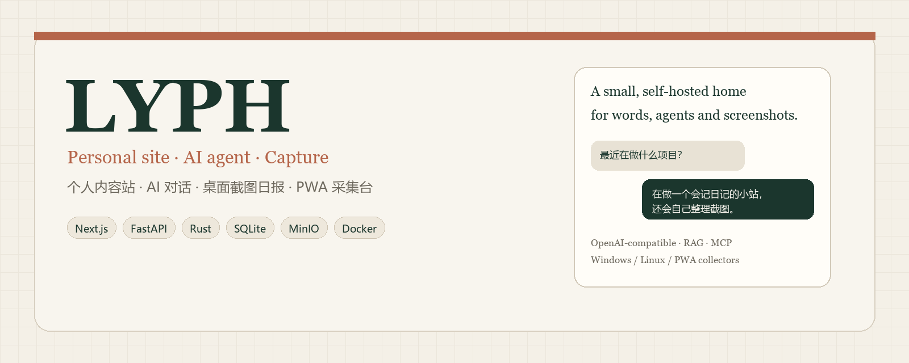
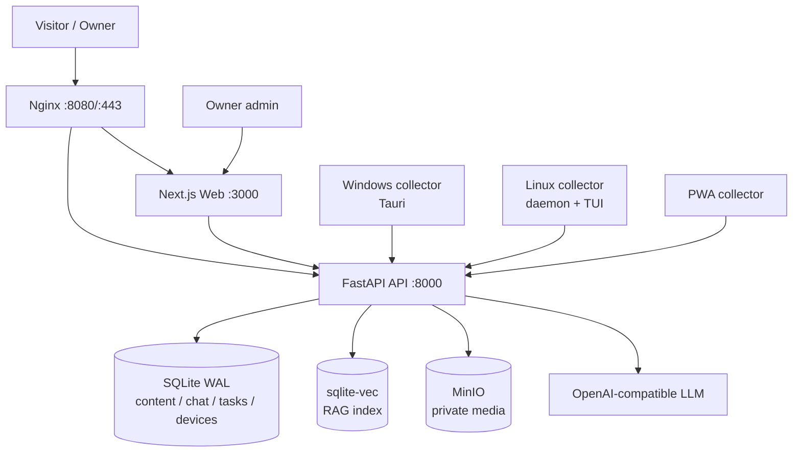

<div align="center">



# LYPH

**A small, self-hosted home for words, agents, and screenshots.**

个人内容站 + AI Agent 对话 + 桌面截图日报 + PWA 采集台。

[简体中文](README.md) · [English](README.en.md)

[](https://nextjs.org/)
[](https://fastapi.tiangolo.com/)
[](https://www.rust-lang.org/)
[](https://docs.docker.com/compose/)
[](LICENSE)
[](https://github.com/Wing233/lyph/actions/workflows/ci.yml)

[快速开始](#快速开始) · [架构](#架构) · [配置](#配置) · [部署](#部署) · [隐私](#隐私与数据) · [开发](#开发)

</div>

---

## 这是什么

LYPH 是一个**可自托管的个人站点 + AI Agent + 采集端**参考实现。

它不是通用 SaaS，也不是内容模板；它把下面这些能力放在一套工程里：

```text
公开站点 / 博客 / 文档 / 日记 / 项目
        +
站主后台（内容、资料、模型、聊天、设备、日报、观测、备份）
        +
AI 对话（OpenAI 兼容模型 / RAG / MCP / 可操作视图）
        +
Windows / Linux / PWA 采集端（截图、速记、日报）
        +
Docker Compose + Nginx + MinIO + SQLite
```

适合这些场景：

- 想要一个完全自托管的个人主页/博客/文档站
- 想让访客和自己的站点 AI 对话，而不是只接一个通用聊天框
- 想从 Windows/Linux 桌面自动采集截图和速记，生成日报
- 想研究一个完整但克制的 FastAPI + Next.js + Rust 全栈项目
- 想在自己的服务器上部署，而不是依赖 SaaS

---

## 功能

<table>
<tr>
<td width="50%" valign="top">

**公开站点**

- 首页 / 项目 / 技术栈 / 兴趣 / 博客 / 文档 / 日记
- 暖纸排版、响应式、可访问性
- 发布快照：编辑草稿不会影响已发布版本
- 公开/私密、RAG 授权、版本恢复
- 导航菜单与首页小球菜单由数据库驱动
- 内容分页、搜索、归档

</td>
<td width="50%" valign="top">

**站主后台**

- 九模块管理：内容、资料、模型、聊天、设备、日报、观测、备份、设置
- Argon2id 密码、HttpOnly Cookie、CSRF
- 模型密钥加密存储，不在前端回显
- 任务持久化、幂等、重试
- 备份/恢复与容量报告
- 插件式导航/内容

</td>
</tr>
<tr>
<td valign="top">

**AI 对话**

- OpenAI 兼容 `/chat/completions`
- RAG：SQLite + sqlite-vec
- MCP / AG-UI 工具协议
- 公开数据工具：项目、文章、企业快照（可选）
- SSE 流式回答、可操作视图（表格/图表/图片）
- 配额、并发、缓存、取消、断流恢复

</td>
<td valign="top">

**采集端**

- Rust 核心 + SQLite 离线队列
- Windows：Tauri 窗口
- Linux：daemon + Ratatui TUI
- iOS：PWA 采集台
- 截图 / 速记 / 上传 / 重试 / 暂停
- 设备 token 只授权设备接口

</td>
</tr>
</table>

---

## 架构



### 请求路径

```text
浏览器
  → Nginx
    → Next.js（页面、同源 /api/v1 代理）
      → FastAPI
        → SQLite / sqlite-vec / MinIO / 模型
```

### 数据边界

| 数据 | 位置 | 说明 |
|---|---|---|
| 内容、聊天、任务、设备 | SQLite | WAL，单进程写 |
| 向量索引 | sqlite-vec | 与 SQLite 同库 |
| 图片、文件、截图 | MinIO | 私有 bucket，签名/受控下载 |
| 模型密钥 | SQLite 密文 | Fernet 加密，服务端解密 |
| 站主密码 | 环境变量 | Argon2id 哈希 |
| 设备 token | 设备本机 | 只授权设备接口 |

---

## 技术栈

| 层 | 技术 |
|---|---|
| Web | Next.js 15.5、React 19、TypeScript、Tailwind CSS 4 |
| API | Python 3.13、FastAPI、Uvicorn、SQLite WAL、sqlite-vec、APScheduler |
| AI | OpenAI 兼容 Chat Completions、RAG、MCP、AG-UI |
| 存储 | MinIO / S3 兼容 |
| 采集端 | Rust、Tauri、Ratatui、rusqlite、reqwest |
| 部署 | Docker Compose、Nginx、Certbot |

---

## 快速开始

### 前置条件

- Docker + Docker Compose **≥ 2.24.4**（使用了 `!override`）
- Python 3.13 + [uv](https://docs.astral.sh/uv/)（仅用于生成配置）
- 一台能跑 Docker 的 Linux 服务器 / NAS

### 1. 克隆并生成配置

```bash
git clone https://github.com/Wing233/lyph.git
cd lyph

uv run --project api lyph init-config \
  --output .env \
  --origin http://127.0.0.1:8080 \
  --minio-endpoint minio:9000
```

它会：

- 生成 `LYPH_SECRET_KEY`
- 生成 MinIO access/secret key
- 要求你输入至少 12 位的站主密码，并生成 Argon2id 哈希
- 写入权限为 `0600` 的 `.env`
- 不覆盖已有 `.env`

> 没有默认密码、默认 API Key 或演示模型。首次启动必须自己生成。

### 2. 构建并启动

```bash
docker compose build minio api web
docker compose up -d
```

打开：

```text
http://127.0.0.1:8080/
http://127.0.0.1:8080/admin/login
```

### 3. 配置模型

进入后台 → 模型 → 新增一个 OpenAI 兼容端点：

```text
base_url   https://api.deepseek.com
model      deepseek-chat
api_key    sk-...
```

密钥会加密保存，前端不会回显。没有配置模型时，聊天接口会明确失败，不会伪造回答。

### 4. 可选：TLS

```bash
# 首次证书（仅 80 端口）
docker compose -f compose.yaml -f compose.acme.yaml up -d

# 正式 TLS
docker compose -f compose.yaml -f compose.tls.yaml up -d
```

证书放在 `runtime/tls/`，ACME challenge 放在 `runtime/acme/`。`LYPH_CERT_NAME` 必填，不再内置任何 IP/域名默认值。

---

## 配置

完整示例见 [`.env.example`](.env.example)。

### 必填

| 变量 | 说明 |
|---|---|
| `LYPH_SECRET_KEY` | ≥32 字符随机密钥，用于加密/签名 |
| `LYPH_OWNER_PASSWORD_HASH` | Argon2id 哈希 |
| `LYPH_FRONTEND_ORIGIN` | 浏览器访问源，如 `https://lyph.example.com` |
| `LYPH_SECURE_COOKIES` | 生产 `true`，本地 HTTP `false` |
| `LYPH_MINIO_ENDPOINT` | MinIO 地址，如 `minio:9000` |
| `LYPH_MINIO_ACCESS_KEY` | MinIO access key |
| `LYPH_MINIO_SECRET_KEY` | MinIO secret key |
| `LYPH_MINIO_BUCKET` | 私有 bucket |
| `LYPH_MINIO_SECURE` | 本地 `false`，生产 `true` |

### Compose / 部署

| 变量 | 默认 | 说明 |
|---|---|---|
| `LYPH_BIND_ADDRESS` | `127.0.0.1` | Nginx 绑定地址 |
| `LYPH_HTTP_PORT` | `8080` | HTTP 端口 |
| `LYPH_PROXY_IP` | `172.30.91.254` | 私有网段内 Nginx 地址 |
| `LYPH_PRIVATE_SUBNET` | `172.30.91.0/24` | 私有网段 |
| `FORWARDED_ALLOW_IPS` | `172.30.91.254` | 可信代理 |
| `LYPH_CERT_NAME` | — | TLS 证书域名/IP |

### 可选

| 变量 | 说明 |
|---|---|
| `LYPH_CHAT_FIRST_ENABLED` | 是否使用聊天优先首页 |
| `LYPH_PUBLIC_ORIGIN` | 公开源，用于元数据 |
| `LYPH_ENTERPRISE_DATABASE_PATH` | 可选企业快照 SQLite；不配置则相关工具不可用 |
| `LYPH_DOCKER_GID` | 可选 UI 预览需要 docker 组 |
| `LYPH_SCHEDULER_ENABLED` | 是否启动调度器 |

> `.env`、`data/`、`runtime/`、`backups/`、`public-apps/` 已在 `.gitignore` 中排除。

---

## 开发

### API

```bash
cd api
uv sync --frozen --extra test
uv run --env-file ../.env uvicorn lyph.main:app --host 127.0.0.1 --port 8000
```

### Web

```bash
cd web
npm ci
API_BASE_URL=http://127.0.0.1:8000 npm run dev
```

### 采集端

```bash
cargo build --locked -p lyph-collector-linux --release
cargo test --locked
```

Windows 需要 Rust 1.95、Visual Studio C++ Build Tools、Windows SDK、WebView2。

### 测试

```bash
# API
cd api && uv run pytest

# Web
cd web && npm run typecheck && npm run build

# Collectors
cargo test --locked
```

---

## 采集端

### 配对

1. 后台 → 设备 → 新建对应平台设备
2. 复制只显示一次的 device token
3. 本机运行：

```bash
lyph-collector init https://your-site.example
```

4. 输入 token（隐藏输入，不写入命令行历史）
5. 启动 daemon / 窗口

### 命令

```text
lyph-collector daemon
lyph-collector tui
lyph-collector note "今天的一条速记"
lyph-collector photo ~/Pictures/a.png
lyph-collector status
lyph-collector pause / resume
lyph-collector sync
lyph-collector capture
```

TUI 中 `q` 只退出 TUI；daemon 继续采集。`s` 暂停/恢复截图，`g` 续传，`c` 手动截图，`n` 写速记。

---

## 隐私与数据

LYPH 会处理访客 IP、聊天正文、截图和审计日志。默认保留策略：

| 数据 | 保留 |
|---|---|
| 原始访客 IP | 30 天 |
| 聊天正文 | 30 天后置空（运行中的请求除外） |
| 截图对象 | 7 天 |
| 审计 / MCP 调用 | 180 天 |
| 备份 | 7 份 |

详见 [docs/PRIVACY.md](docs/PRIVACY.md)。

部署者必须：

- 在隐私政策中说明采集范围
- 提供删除/导出联系方式
- 不要公开真实访客数据、聊天记录、截图
- 不要把 `data/`、`runtime/`、`backups/` 提交到 git

---

## 部署

### 最小 HTTP

```bash
docker compose up -d
```

### TLS

```bash
docker compose -f compose.yaml -f compose.tls.yaml up -d
```

### 反向代理

默认 Nginx 已包含：

- 静态/Next.js 代理
- `/api/` 代理
- 安全响应头
- 私网 upstream

如果你在外层再放一层 Nginx/Caddy，请把 `LYPH_BIND_ADDRESS` 改成 `127.0.0.1`，并只暴露外层代理。

### 备份

```bash
uv run --project api --env-file .env lyph backup
uv run --project api --env-file .env lyph restore backups/<file>.lyph.enc
```

恢复前先停止 API 和任务 worker。

### 升级

```bash
git pull
docker compose build minio api web
docker compose up -d
```

升级前备份。SQLite 迁移只做增量建表/加列，不自动删除数据。

---

## 安全

- 没有默认密码、默认模型 Key、默认 MinIO 密码
- 站主密码 Argon2id，Cookie HttpOnly/SameSite=Strict/Secure
- 写请求需要 CSRF token
- 模型密钥 Fernet 加密，前端不回显
- 设备 token 只授权设备接口
- 公开内容与草稿分离，发布使用快照
- 文件下载检查发布引用，HTML/SVG 强制附件和 nosniff
- 可选 UI 预览会挂 Docker socket，**高风险**，不要暴露公网

漏洞报告见 [SECURITY.md](SECURITY.md)。

---

## 目录

```text
api/          FastAPI、SQLite、MinIO、模型、聊天、设备、日报
web/          Next.js 公开站、后台、PWA、聊天 UI
collectors/   Rust 核心、Windows Tauri、Linux daemon/TUI
deploy/       Nginx、TLS、MinIO、发布脚本
docs/         架构、配置、部署、隐私
compose*.yaml Docker Compose
```

---

## 当前状态

这是一个**可运行的个人站点参考实现**，不是通用 SaaS：

- 核心 HTTP 栈、后台、内容、聊天、采集端代码完整
- 企业快照子应用和数据不在仓库内；没有数据时相关工具明确不可用
- 生产 TLS、证书、备份需要在你的环境验证
- Windows 采集端需要真机验证 MSVC/WebView2
- Linux 采集端在 Xvfb 下验证，Wayland/物理桌面需单独测试

---

## Roadmap

- [ ] 更完整的端到端测试
- [ ] 可选的 Web 管理台独立部署
- [ ] 更细的 RAG 评测集
- [ ] 采集端自动更新
- [ ] 多语言站点内容
- [ ] OpenTelemetry 指标
- [ ] 更完整的无障碍审计

---

## 贡献

欢迎 Issue、PR、文档和测试。请先读 [CONTRIBUTING.md](CONTRIBUTING.md)。

```bash
git clone https://github.com/Wing233/lyph.git
cd lyph
# API
cd api && uv sync --frozen --extra test && uv run pytest
# Web
cd ../web && npm ci && npm run typecheck
# Collectors
cd .. && cargo test --locked
```

不要提交 `.env`、`data/`、`runtime/`、`backups/`、真实访客数据或截图。

---

## License

[MIT](LICENSE) © 2026 Wing233

MinIO 是独立的 AGPL-3.0 组件，不适用本项目的 MIT 授权；详见 [THIRD_PARTY_NOTICES.md](THIRD_PARTY_NOTICES.md)。

---

## 相关项目

- [微桥 WeChat Agent Router](https://github.com/Wing233/wechat-agent-router) — 把微信变成多台电脑上 AI Agent 的遥控器

---

## 致谢

- [Next.js](https://nextjs.org/) / [React](https://react.dev/) / [Tailwind CSS](https://tailwindcss.com/)
- [FastAPI](https://fastapi.tiangolo.com/) / [Uvicorn](https://www.uvicorn.org/)
- [SQLite](https://sqlite.org/) / [sqlite-vec](https://github.com/asg017/sqlite-vec)
- [MinIO](https://min.io/)
- [Tauri](https://tauri.app/) / [Ratatui](https://ratatui.rs/)
- [Playfair Display](https://fonts.google.com/specimen/Playfair+Display)
- [Lucide](https://lucide.dev/) / [assistant-ui](https://www.assistant-ui.com/)

> LYPH 是独立项目，与上述服务/品牌无官方关联。
