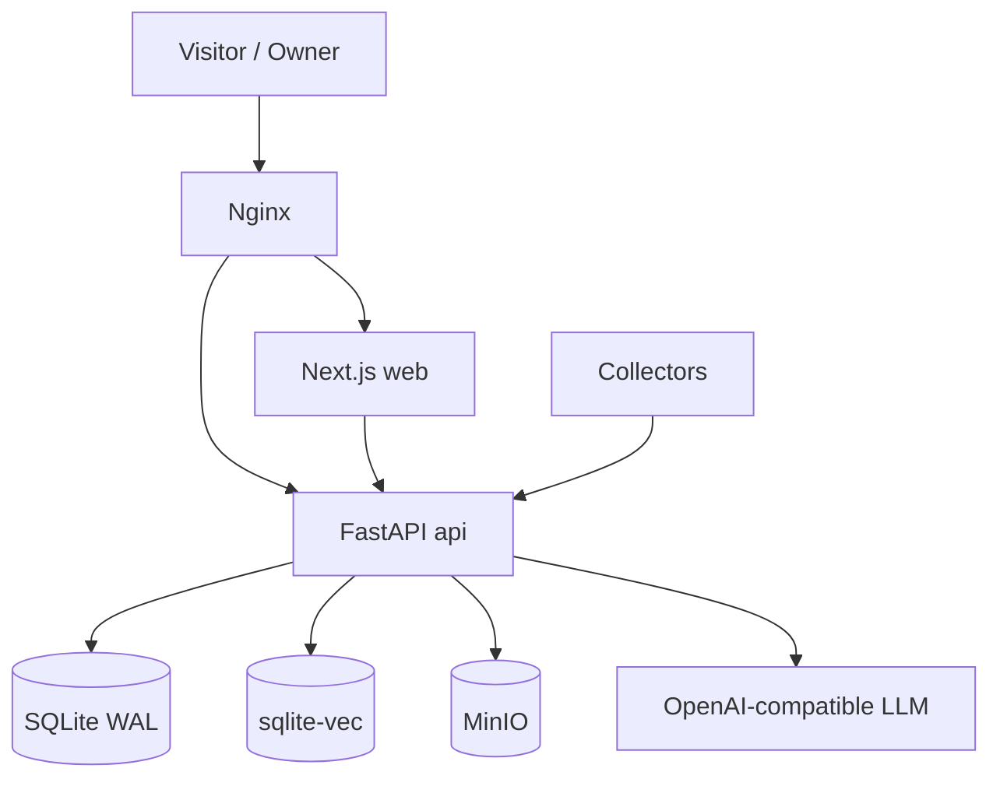
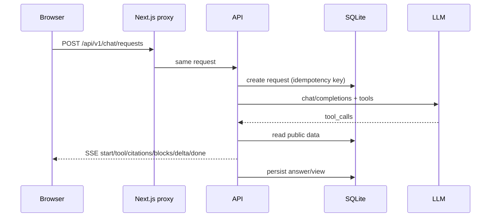
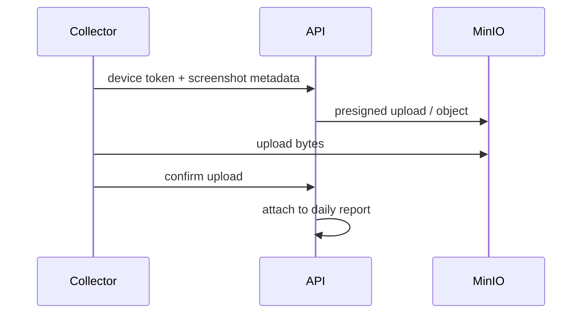

# 架构

## 总览



- **Nginx**：唯一入口，负责 TLS、静态/代理、安全响应头。
- **Web**：Next.js App Router，公开站 + 后台 + PWA + 聊天 UI；浏览器只请求同源 `/api/v1`。
- **API**：FastAPI，认证、内容、聊天、设备、日报、任务、备份。
- **SQLite**：内容、聊天、任务、设备、导航、设置；WAL 模式。
- **sqlite-vec**：RAG 向量索引，与 SQLite 同库。
- **MinIO**：私有媒体对象，签名/受控下载。
- **LLM**：后台配置的 OpenAI 兼容端点。

## API 模块

| 模块 | 职责 |
|---|---|
| `main.py` | FastAPI 应用、路由挂载、启动/关闭 |
| `db.py` | SQLite schema、事务、迁移 |
| `auth.py` | 登录、session、CSRF、失败限流 |
| `content.py` | 内容 CRUD、发布快照、公开查询 |
| `chat.py` | 访客会话、请求、SSE、配额、缓存 |
| `chat_agent.py` | 工具循环、模型调用、follow-up |
| `chat_tools.py` | 只读公开数据工具（项目/文章/企业可选） |
| `chat_views.py` | 可操作视图（表格/图表/图片） |
| `knowledge.py` | RAG 索引/检索 |
| `devices.py` | 设备配对、截图/速记、对象存储 |
| `daily.py` | 日报生成 |
| `models_routes.py` | 模型配置/加密/测试 |
| `settings_routes.py` | 站点设置、导航、联系方式 |
| `operations.py` | 保留期清理、审计、容量 |
| `tasks.py` | 持久化任务、租约、幂等、重试 |
| `ui_routes.py` | UI 预览/发布（可选，Docker socket） |

## 内容发布模型

```text
草稿 (contents)
  → 发布 (content_snapshots)
    → 公开列表/正文
```

- 编辑草稿不会改变已发布快照。
- 取消公开/RAG 授权立即生效。
- 版本恢复进入草稿，需要重新发布。
- 公开正文按稳定 ID 读取，旧日期路径兼容。

## 聊天链路



- `request_id` 是幂等键；同一请求不能更换输入。
- 断流后用 `GET /chat/requests/{id}` 恢复。
- `cache_mode=refresh` 使用新请求绕过缓存。
- 公开数据工具只读；模型参数不会直接变成 SQL/URL。

## 采集端



- 设备 token 只授权设备接口。
- 本地 SQLite 队列保证离线可重试。
- 截图默认保留 7 天。

## 任务与调度

- 任务持久化在 SQLite：`queued/running/succeeded/failed`。
- 单 worker 执行；租约 + 心跳；重启恢复 running。
- APScheduler 只启动受跟踪的异步执行器，不阻塞主循环。
- 连续中断标记 failed，站主可显式重试。

## 安全边界

| 边界 | 机制 |
|---|---|
| 浏览器 → API | 同源、Origin 校验、CSRF、HttpOnly Cookie |
| 模型密钥 | Fernet 加密，服务端解密 |
| 公开内容 | 发布快照 + `PUBLIC_WHERE` |
| 文件 | MinIO 私有 bucket、引用检查、nosniff |
| 设备 | 独立 token、设备接口白名单 |
| UI 预览 | 可选 Docker socket，高风险，默认关闭 |
